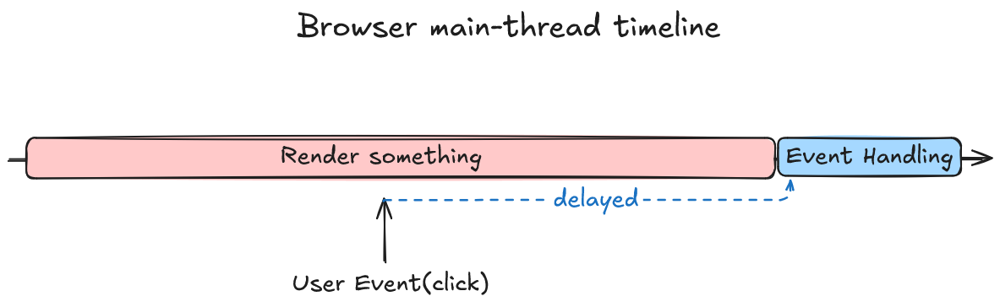
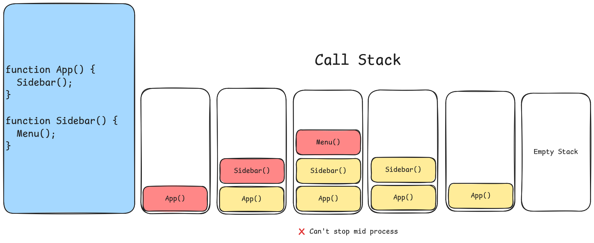
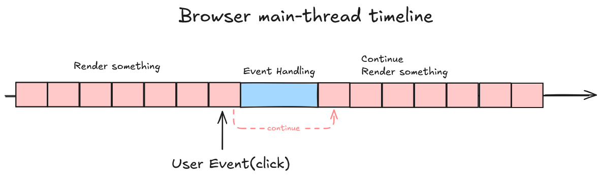

React adalah sebuah library JavaScript yang sering kita pakai saat ingin develop sebuah website.
Tapi tau gak sih apa yang membuat React itu peak? Jawabannya ada pada implementasi Fiber di React 16.

Kita tau bahwa browser memiliki [main thread](https://developer.mozilla.org/en-US/docs/Glossary/Main_thread)
yang fungsinya bisa untuk menjalankan JavaScript, memproses input user, bahkan menggambar layar/UI.
Jadi di dalam satu thread tersebut memiliki beberapa pekerjaan yang berbeda,
dan semuanya harus selesai dalam jatah waktu yang terbatas.
Nah masalah terjadi ketika sebuah fungsi panjang/besar dipanggil,
fungsi tersebut tidak dapat berhenti di tengah-tengah atau di stop dahulu,
sehingga fungsi tersebut ngeblock pekerjaan lain yang menyebabkan ngefreeze, atau ngehang.

_Blok pink itu JavaScript, blok biru itu pekerjaan lain di main thread. Klik dari user datang saat render masih jalan, dan baru diproses setelah render selesai._

Contohnya pada re-render atau render ulang. Pada React 15,
re-render ini sendiri merupakan fungsi panjang yang menelusuri
seluruh komponen tree dalam satu kali jalan. Jadi saat proses re-render terjadi,
pekerjaan lain seperti memproses input user atau menggambar UI ikut menunggu,
karena memang berjalan pada thread yang sama.

Lalu pertanyaannya, kenapa fungsi sepanjang itu nggak bisa berhenti di tengah-tengah? Karena posisinya ada di [call stack](https://developer.mozilla.org/en-US/docs/Glossary/Call_stack). Setiap kali sebuah fungsi dipanggil, JavaScript menaruh fungsi itu di call stack. Masalahnya, call stack itu nggak punya tombol pause. Selama fungsinya belum selesai, fungsi itu tetap ada di dalam call stack, dan pekerjaan lain baru bisa mulai setelah call stack itu kosong.
Jadi selama re-render berjalan, React 15 harus menyelesaikan penelusuran seluruh komponen sampai akhir. Nggak ada cara buat menyimpan posisinya, lalu lanjut lagi nanti dari titik yang sama.

_Di call stack, fungsi cuma bisa masuk dan keluar. Nggak ada cara menyimpan tumpukan ini di tengah jalan untuk dilanjutkan nanti._

Nah React 16 milih jalan lain. Kalau memang call stack nggak bisa stop di tengah jalan, ya udah, jangan pakai call stack. Mereka memilih untuk menyimpan posisi tersebut di sebuah object. Satu object untuk satu komponen, dan object ini yang disebut Fiber. Perubahan ini bukan perbaikan kecil, karena cara React menelusuri komponen memang bergantung pada call stack. Seluruh cara kerjanya harus diganti.

Karena posisinya sekarang di object, dan object itu hidup di memory, React bisa berhenti di tengah render, simpan object terakhir yang sedang dikerjakan, keluar, lalu balik lagi nanti dari object yang sama. Persis seperti yang nggak bisa dilakukan call stack tadi.

_Render dipecah jadi potongan kecil. Di sela dua potongan, React berhenti supaya browser bisa memproses klik, lalu lanjut lagi dari posisi yang sama._

Jadi itu jawabannya mengapa React harus punya arsitektur baru (Fiber). Karena sekarang React punya pilihan: mana yang dikerjakan dulu, dan mana yang sudah nggak perlu dilanjutin karena ada update yang lebih baru. Dari situ semua fitur concurrent di React modern berdiri.

Banyak simplifikasi di tulisan ini. Di kode aslinya masih banyak yang nggak saya bahas, misalnya bagaimana React memilih pekerjaan mana yang dikerjakan lebih dulu, atau bagaimana cara dia menukar tree lama dengan tree baru.

Next time deh.

## Referensi

- [React Fiber Architecture](https://github.com/acdlite/react-fiber-architecture)
- [React v16.0](https://legacy.reactjs.org/blog/2017/09/26/react-v16.0.html)
- [Render and Commit](https://react.dev/learn/render-and-commit)
- [The event loop](https://developer.mozilla.org/en-US/docs/Web/JavaScript/Reference/Execution_model)
- [ReactFiber.js](https://github.com/react/react/blob/main/packages/react-reconciler/src/ReactFiber.js)
